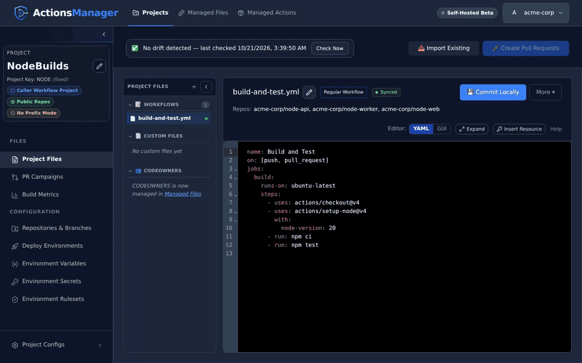

# ActionsManager

**Manage GitHub Actions workflows across many repositories from one place.**

The same CI workflow gets copied into every repository, and the copies drift apart: one repo pins an old action, another skips a step, a third was hand-edited during an incident. ActionsManager keeps one definition per file, delivers it to every repository and branch in a project as pull requests, and tells you when a repository's copy no longer matches what it delivered.

[](https://github.com/greywolflabs/actions-manager/releases)
[](LICENSE)
[](https://github.com/greywolflabs/actions-manager/actions/workflows/publish-self-hosted-image.yml)
[](https://github.com/greywolflabs/actions-manager/pkgs/container/actions-manager)



## Quick start

Run ActionsManager as a single self-hosted container on port 8080. Generate a secret key once and keep it (use the same value on every restart):

```bash
openssl rand -hex 32
```

```bash
docker run -d \
  --name actions-manager \
  -p 8080:8080 \
  -v actions-manager-data:/app/data \
  -e INSTALLATION_MODE=self-hosted \
  -e SECRET_KEY=<your_generated_key> \
  -e ALLOW_INSECURE_HTTP=true \
  ghcr.io/greywolflabs/actions-manager:latest
```

`ALLOW_INSECURE_HTTP=true` is required because this command serves the app over plain HTTP. Drop it once you put ActionsManager behind HTTPS — see the [HTTPS setup guide](https://actionsmanager.io/getting-started/https-setup).

Then open `http://localhost:8080`, choose **Sign in with Personal Access Token**, and paste a fine-grained or classic PAT. Do **not** put personal PATs in Docker command lines, shell history, screenshots, or committed environment files.

**→ [Documentation](https://actionsmanager.io)** &nbsp;·&nbsp; **→ [First workflow walkthrough](https://actionsmanager.io/getting-started/first-workflow-walkthrough)** &nbsp;·&nbsp; **→ [Demo video](https://youtu.be/8TrgE9YDGXA)**

ActionsManager is in a free, self-hosted beta. See the [Beta Notes](BETA.md) for its limits and your responsibilities as an operator.

## Features

- **[Projects](https://actionsmanager.io/features/projects.html)** group repositories with the files you manage for them: workflows and custom files.
- **[PR campaigns](https://actionsmanager.io/features/pr-campaigns.html)** deliver a change to every repository and branch in a project as pull requests, which you review, merge, close or roll back from one place.
- **[Drift detection](https://actionsmanager.io/features/drift-detection.html)** re-checks every repository and branch in the background and shows when a delivered file was edited or deleted in GitHub. Keep ActionsManager's version through a pull request, or use GitHub's, the same way for workflows, custom files and CODEOWNERS.
- **[Reusable and caller workflows](https://actionsmanager.io/features/reusable-workflows.html)**: author reusable workflows in a Reusable Workflow Project and link them into the Caller Workflow Projects that use them.
- **[Workflow editor](https://actionsmanager.io/features/workflows.html)** in YAML or a GUI view, with [build-type detection](https://actionsmanager.io/features/build-detection.html) (Maven, Gradle, npm, .NET, Python, Go, Rust, Docker and more) to start from a matching template.
- **Secrets, variables, deploy environments and [rulesets](https://actionsmanager.io/features/rulesets.html)** managed across a project's repositories.
- **[Managed actions](https://actionsmanager.io/features/managed-actions.html)**: a shared catalog of third-party actions and their inputs for the GUI editor.
- **[Managed files](https://actionsmanager.io/features/managed-files.html)**: one project owns a repository file, such as CODEOWNERS, for each of its repositories, and delivers it by PR campaign.
- **[Build metrics](https://actionsmanager.io/features/build-metrics.html)**, **[notifications](https://actionsmanager.io/features/notifications.html)**, **[permissions](https://actionsmanager.io/features/permissions.html)** and **[backup and restore](https://actionsmanager.io/features/backup-restore.html)**.

## How it compares

| Tool | What it does | What ActionsManager adds |
|---|---|---|
| [repo-file-sync-action](https://github.com/BetaHuhn/repo-file-sync-action) | A GitHub Action in a source repository that copies files to other repositories, by pull request by default, each time the source repository changes. | A record of what was delivered to each repository and branch, drift reports when a target repository changes a file later, and a UI. |
| [multi-gitter](https://github.com/lindell/multi-gitter) | A CLI that runs a script in many repositories and opens a pull request wherever it changes something, tracking those pull requests by branch name. | Files that stay managed: one definition, delivered and then checked for drift per repository and branch. |
| [Renovate](https://docs.renovatebot.com/) | Keeps dependency versions up to date, including action and reusable-workflow versions inside existing workflow files. | It writes and delivers the workflow files themselves. The two work well together. |
| [GitHub rulesets: required workflows](https://docs.github.com/en/enterprise-cloud@latest/repositories/configuring-branches-and-merges-in-your-repository/managing-rulesets/available-rules-for-rulesets#require-workflows-to-pass-before-merging) | Makes pull requests in targeted repositories pass a workflow from a central repository. Documented for GitHub Enterprise Cloud and Enterprise Server. | The workflow, custom files and CODEOWNERS land in each repository and branch, with drift tracking. |

## Requirements

- **Docker 20.10+** or **Podman 3.0+**, on Linux or macOS, with 4 GB+ RAM and 10 GB+ disk.
- A GitHub account with access to the repositories you'll manage, and a **personal access token** (fine-grained recommended, classic supported) or a **GitHub OAuth App** for "Log in with GitHub". Saved tokens are encrypted at rest and never returned to the UI.

### Recommended PAT permissions

| Permission | Level | Required for |
|-----------|-------|-------------|
| Metadata | Read-only | All operations |
| Contents | Read and write | Workflow file management |
| Actions | Read and write | Workflow triggering |
| Pull requests | Read and write | PR-based delivery |
| Secrets | Read and write | Repository secrets management (optional) |
| Variables | Read and write | Repository variables management (optional) |

See [GitHub PAT Setup](docs/GITHUB_PAT_SETUP.md) for token creation and [GitHub OAuth Setup](https://actionsmanager.io/getting-started/github-oauth-setup.html) for OAuth.

## Documentation

- **Install and run:** [Self-Hosted Installation](INSTALLATION.md) (Docker run and Compose, TLS, backups), [Self-Hosted Docker Deployment](DOCKER_DEPLOYMENT_MODES.md), [Environment Variables](docs/ENVIRONMENT_VARIABLES.md)
- **Use it:** [Documentation site](https://actionsmanager.io), [Product demo](https://actionsmanager.io/getting-started/product-demo), [Troubleshooting](https://actionsmanager.io/troubleshooting.html)
- **Policies:** [Beta Notes](BETA.md), [Security Policy](SECURITY.md), [Privacy Notice](PRIVACY.md)
- **Contribute:** [CONTRIBUTING.md](CONTRIBUTING.md), [Development Guide](docs/DEVELOPMENT.md), [Frontend Development](docs/FRONTEND_DEVELOPMENT.md)

Found a problem? Check the [issues](https://github.com/greywolflabs/actions-manager/issues). The API docs are at `/docs` on a running backend when `DISABLE_API_DOCS=false` (off by default in production).

## License

ActionsManager is developed by GreyWolf Labs and licensed under the [Apache License 2.0](LICENSE). Redistributions must keep the attribution in [NOTICE](NOTICE). The [Privacy Notice](PRIVACY.md) describes what a self-hosted install stores and where.
