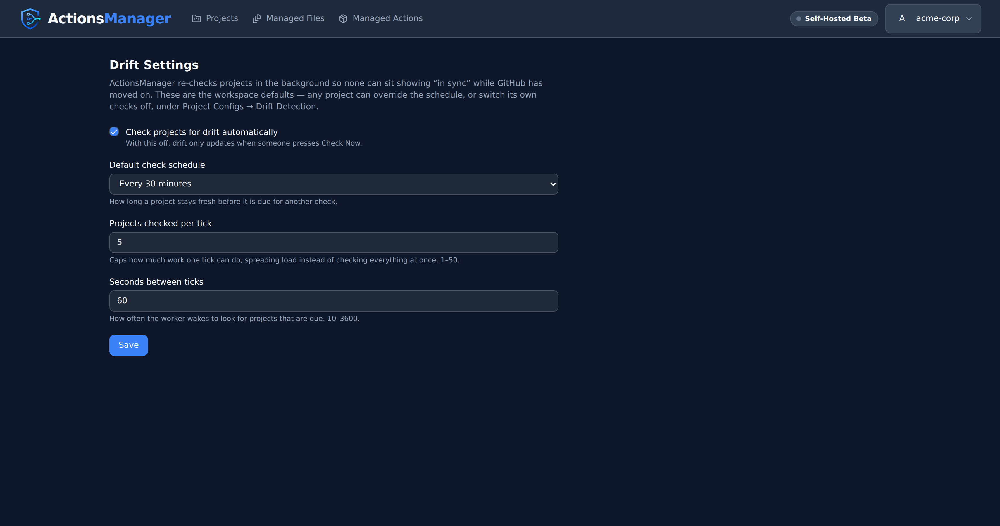
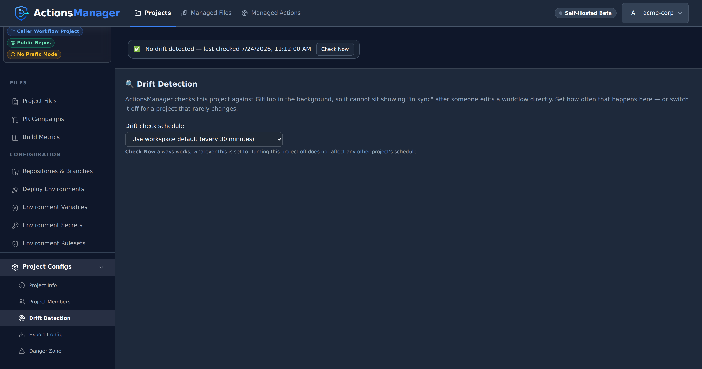
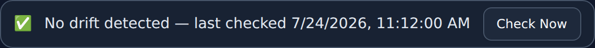
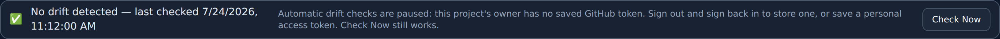
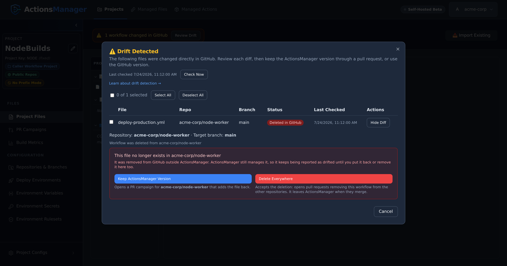
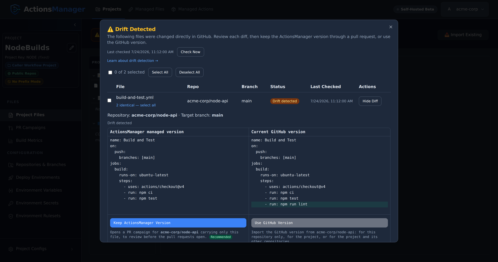
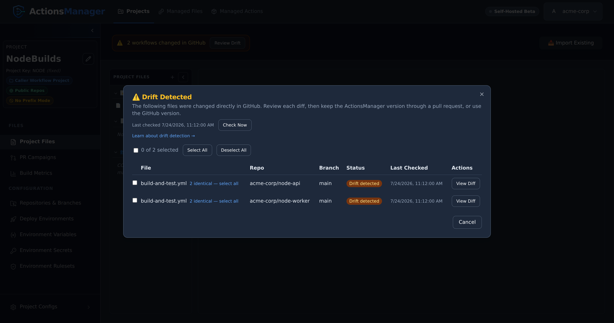
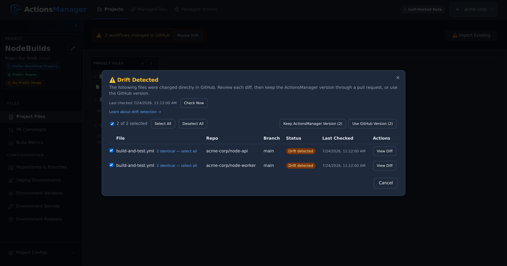

Continuously detect when repositories diverge from their managed workflow state and resolve the differences.

---

## What is Drift?

**Drift** occurs when the workflow content in a repository diverges from the definition managed by ActionsManager. Common causes include:

- Manual edits to workflow YAML files in the repository
- Direct commits that bypass ActionsManager
- Merging PRs that modify managed workflow files outside of a campaign
- Workflow files deleted or renamed in the repository — the managed filename is gone, so it reads
  as deleted
- Someone reverting or re-editing a file ActionsManager delivered

Drift always means **GitHub changed underneath ActionsManager**. A change you made *inside*
ActionsManager and haven't delivered yet is not drift — see [What Counts as Drift](#what-counts-as-drift).

## How Drift Detection Works

ActionsManager compares the **managed definition** it holds for each workflow against the file that
is actually in the repository, for every repository and branch the project delivers to. When they
differ, that (workflow, repository, branch) is marked as **drifted**.

For each repository and branch, a check:

1. Lists `.github/workflows/` in a single call, which returns the current Git SHA of every workflow
   file on that branch.
2. Compares each managed workflow's stored SHA against the SHA in that listing. Matching SHAs mean
   no drift, and no further calls.
3. Fetches the full file only for workflows whose SHA differs, then compares the content.

Content comparison ignores differences that carry no meaning: line endings (CRLF vs LF), trailing
whitespace on a line, and a missing or extra final newline. **Everything else counts** — comments,
key order, indentation and blank lines are all part of the comparison, because ActionsManager
delivers the file exactly as stored. When content matches despite a different SHA (someone
committed the same bytes another way), the workflow is in sync and ActionsManager quietly re-records
GitHub's SHA so the file isn't re-fetched on the next check.

The file compared is the one ActionsManager delivered there: the project's workflow, read at the
path it was delivered to on that repository and branch. A workflow renamed in ActionsManager but not
yet delivered under its new name is still read at its old path, so a pending rename is never
reported as a deletion. Workflow files in the repository that this project
does not manage are never examined, and a file carrying a different project's code is skipped rather
than reported as drift.

If a repository has a **repo-specific override** for a workflow, that repository is compared against
the override rather than the shared project workflow. That is what an override is for — a
deliberately different copy stops reporting drift.

## When Drift Is Checked

**Automatically, in the background.** ActionsManager re-checks projects on its own, so a project
cannot sit showing "in sync" while GitHub has moved on. By default a project becomes due for a
re-check 15 minutes after its last one, and only a few projects are picked up per tick so the load
stays spread out.

**Workspace admins set the defaults.** Under **Drift Settings**, an admin can switch automatic
checking off entirely, change how long a project stays fresh before it is due again, and tune both
how many projects are picked up per tick and how often those ticks happen. Changes apply from the
next tick — no restart. With automatic checking off, drift only updates when someone presses
**Check Now**.

**Each project can set its own schedule.** Open a project, then **Project Configs → Drift
Detection**, and pick a schedule for that project alone — so you can configure checking on an
as-needed basis:

| Setting | What it does |
|---|---|
| Use workspace default | Follows whatever the admin configured. This is how every project starts. |
| Off | This project is never checked automatically. **Check Now** still works. |
| Every 15 / 30 minutes | For projects edited often, or where drift matters quickly. |
| Every hour / 6 hours | A middle ground for steadier projects. |
| Daily | For projects that rarely change, or to keep API usage down. |

Turning a project off does not slow down the projects behind it, and it never
affects any other project's schedule.

**On demand, with Check Now.** A project with no known drift shows a status row with a **Check Now**
button; when something is drifted, **Review Drift** opens the list, which carries **Check Now** next
to the last-checked time. Either one runs a live check immediately, using your own credentials.

**Opening a project does not run a check.** The drift panel is served from the last stored result
and costs no GitHub API calls, so opening a project page as often as you like is free. The panel
always says *when* that result was established — "last checked …", or "Not checked yet" if no check
has ever completed.

**Actions that fix drift update the stored state directly.** Merging a pull request that puts the
project's version back, using GitHub's version, and merging the pull requests that delete a
workflow everywhere all clear the drift they resolved, for exactly the repositories and branches
they touched. The banner clears
straight away — there is no wait for the next sweep, and no extra GitHub calls.

Two things the background sweep deliberately does **not** do:

- **It never writes to GitHub.** The sweep only reads and reports. Every change to a repository
  still comes from you choosing a resolution.
- **It never claims a check that didn't happen.** If a project can't be checked, its last-checked
  time stays where it was instead of moving forward.

### When automatic checks pause

The background sweep runs with nobody logged in, so it needs a credential stored on the server. It
checks a project only when the project's **owner** has one.

Signing in stores that credential, so a normal GitHub login is enough — it survives restarts and is
shared across replicas. A saved personal access token works too, and takes precedence.

The one case that still pauses: an account that was already signed in before this behaviour shipped.
Its credential exists only in the server's memory, and gets written to storage on that account's
next request — but only while that same process is still running. If the server restarts first,
there is nothing left to recover, and the owner has to sign in again once (or save a PAT).

A project the sweep can't check is skipped, keeps its previous result and timestamp, and the drift
panel explains why:

> Automatic drift checks are paused: this project's owner has no saved GitHub token. Sign out and
> sign back in to store one, or save a personal access token. Check Now still works.

**Check Now** still works in that state.

A project whose checks keep failing — an expired token, a rate limit, a repository that can no
longer be read — is retried progressively less often: the wait doubles with each consecutive
failure, up to 32× that project's own schedule. The first successful check restores the normal
cadence. A pause is not a failure, so it clears that count: once the owner's credential is back, a
paused project returns to its normal schedule instead of waiting out a stretched one.

## What Counts as Drift

Drift is a list of things *someone else* changed. Work in progress inside ActionsManager is tracked
as a [workflow status](workflows.html#workflow-status) instead, so it never
pollutes that list.

| Situation | Reported as drift? | What you see instead |
|---|---|---|
| The file in GitHub is not the version ActionsManager delivered there | **Yes** | Drift detected, with a diff |
| The delivered file is gone from GitHub | **Yes** | Deleted in GitHub |
| You edited the workflow in ActionsManager and haven't delivered it yet, and GitHub still holds what was delivered | No | Workflow status **Committed Locally** — pending delivery |
| The workflow is in an open ActionsManager pull request that changes it | No | Workflow status **Under Review** |
| The workflow is missing from the branch, but an open ActionsManager PR would add it | No | Pending merge |
| The workflow has never been delivered to that repository or branch, even if a different file is there | No | Not delivered yet — there is no delivered file to compare against |
| The file differs only in line endings, trailing spaces or its final newline | No | In sync |
| The repository has a repo-specific override and matches it | No | In sync — compared against the override |
| GitHub could not be queried | No | "Couldn't check …" in the status row / *Needs attention* on the project badge — never reported as in sync |

A local edit neither creates drift nor hides it: drift compares GitHub with what ActionsManager
delivered, and your edit is shown by the workflow's status. A file someone changed on GitHub stays
reported while your edit waits to be delivered. The one edit that resolves drift is one that makes
the workflow exactly GitHub's copy — whether you **Commit Locally**, restore an earlier version or
import over it: that drift is resolved at once, and GitHub's copy counts as delivered there. A
repository with a repo-specific override keeps its drift, because it is compared against the
override, which the edit does not change.

An open pull request suppresses drift only for the workflows that PR actually carries, in that one
repository. Everything else in the project is still checked normally. Closing a fix PR without
merging it does **not** suppress drift: the file in GitHub still differs, so it is reported again on
the next check.

## Which Branches Are Checked

Drift is checked against **the branches the project delivers to** — the same branches
ActionsManager writes when it syncs, resolved from the project's
[branch configuration](projects.html#branch-configuration) and any per-repository
override.

- **Default branch** mode compares against the repository's default branch.
- **Pattern** mode compares against every branch matching the pattern (subject to the recency
  filter), and each is reported separately.

So a project targeting `release/*` is compared against those release branches, not against `main`.
A workflow can be in sync on `release/2.0` and drifted on `release/2.1`; the drift table shows one
row per branch, with its own diff and its own resolve action. Resolving drift on one branch does
not affect the others.

Because each branch is tracked independently, drift appearing on a second branch raises its own
notification rather than being folded into the first.

Pattern mode also applies a **recency filter** — 30 days by default. Branches that match the pattern
but have had no commit inside that window are skipped, so long-dead release branches aren't checked
forever. A repository can override the whole branch configuration for itself — option, pattern and
recency window — and drift honours that override exactly as delivery does.

If pattern mode matches nothing (no branch matches, or every match is too old), ActionsManager falls
back to the repository's default branch rather than checking nothing at all.

Reusable workflow files published by a Reusable Workflow Project are the exception: they are compared in
the repository that publishes them, on **that repository's default branch** — the branch pattern configured for a project applies to the
caller workflows it delivers, not to published reusable workflow files.

If ActionsManager cannot determine which branches to check — an expired token, a rate limit, a
repository it can no longer read — those workflows are counted as **unchecked**, not as
synchronized. An unknown answer is never presented as a clean one.

### Cost of a check

Checking a branch means asking GitHub what is in it, which uses your GitHub API allowance. With
re-checks running automatically, that cost has to stay near zero for a project nobody is touching —
and it does:

- **Opening a project costs nothing.** The panel renders from the stored result; no GitHub call is
  made until you press **Check Now** or open a diff.
- Each branch's workflow listing — and the repository's branch listing itself — is requested
  **conditionally**. If nothing moved, GitHub answers "not modified", and those responses do not
  count against your API rate limit at all.
- The "has this branch been committed to recently" answer is remembered against the branch's head
  commit, so it is re-asked only when the branch actually moves. It is never cached on a timer, so
  a branch that has just become active is picked up immediately.
- Full file content is fetched only for workflows whose SHA changed, and GitHub's side of a diff is
  fetched only when you open that diff.
- CODEOWNERS and each custom file are read one conditional call per branch. A custom file is read
  only on the branches ActionsManager delivered it to, or has an open pull request carrying it to:
  anywhere else it is not delivered yet, whatever GitHub holds, so asking would cost for nothing.

In practice a re-check of an untouched project costs roughly one conditional call per repository,
which is what makes checking every project on a schedule affordable.

## Drift States

| State | Where it appears | Description |
|-------|------------------|-------------|
| No drift detected | Project status row | The saved result is clean: every file checked matches the managed definition |
| Drift detected | Drift row, project badge | The file in the repository differs from the managed definition |
| Deleted in GitHub | Drift row | The file was removed from the repository outside ActionsManager |
| Needs attention / Couldn't check | Project badge, status row | The last check could not complete for one or more repositories |
| Not checked (yet) / Drift status unknown | Project badge, status row | No drift check has ever completed, or the last one could not complete and automatic checks are paused |

Each drift row is one **(file, repository, branch)**, where the file is a workflow, a custom file
or CODEOWNERS. The same file can be drifted in one repository and in sync in another, or drifted on
one branch and clean on another, and each is resolved on its own.

### When the file was deleted in GitHub

If someone removes a file from a repository outside ActionsManager, the drift panel says
**Deleted in GitHub** rather than showing an empty diff, and offers the choices that actually
apply:

- **Keep ActionsManager Version** — opens a [PR campaign](pr-campaigns.html) for that repository
  that adds the file back. It works the same for workflows, custom files and CODEOWNERS.
- **Delete Everywhere** (workflows only) — accepts the deletion. Opens pull requests removing the
  workflow from the project's other repositories; once they merge, the workflow leaves
  ActionsManager, version history included. The confirmation names every repository that will be
  affected.

**Use GitHub Version** is not offered here, because there is no content in GitHub to use. To accept
the deletion of a custom file, [remove it from the project](workflows.html#removing-a-custom-file).
CODEOWNERS is what its project is for, so to stop managing it in a repository, remove that
repository from the project.

Until you choose one, the file keeps being reported as drifted: ActionsManager still manages a
file that no longer exists in the repository.

**Deleted means a file that was really there is gone.** ActionsManager only reports a workflow as
deleted from a repository and branch where it has a record of the file being there: a pull request
that delivered it merged, a drift check saw it, or you made that copy the project's version. A workflow
whose pull request is still open has never been on the target branch, so its absence there is
pending merge — opening a campaign does not put the project into drift. The same holds for a
repository or branch newly added to an existing project: nothing has been delivered there yet, so
nothing can have been deleted. This is judged per (workflow, repository, branch) from that
workflow's own delivery history, so an unrelated file that once had the same name in the repository
has no bearing on it.

Because a newly added repository is silent in the drift list, ActionsManager says so elsewhere
instead: saving a repository into a project prompts you to
[deliver the project's files to it](projects.html#adding-a-repository-to-a-project-that-already-has-files)
or keep the change local, and if you keep it local a
[standing reminder](projects.html#keeping-track-of-whats-still-waiting) tracks what
is still waiting. "Not drifted" here means "nothing has been delivered yet", not "in sync" — the two
readings look identical in the drift list, which is exactly why the reminder lives outside it.

### When a check can't complete

If GitHub can't be queried — an expired or revoked token, a rate limit, or a GitHub outage —
ActionsManager counts those workflows as **unchecked** rather than guessing at their state:

- They are **not** reported as deleted. A failed repository listing is not the same as a repository
  with no workflows, and treating it as one previously made every workflow in that repository look
  like it had been deleted from GitHub.
- They are **not** recorded as resolved. The last known drift state is left untouched, and no
  `drift.resolved` notification is sent, so a genuinely drifted workflow is never silently marked
  clean because a check failed.
- The project is badged **Needs attention** rather than in sync, and the project's status row agrees.
  Right after **Check Now** it says how many workflows could not be checked ("Couldn't check N
  workflows — GitHub didn't respond"). When you open the project later it says "Couldn't check some
  workflows — drift status may be out of date", with the saved summary beside it (for example
  "12 workflow/repo pair(s) could not be checked"). It never shows "No drift detected" for that
  result: an empty drift list only means "everything is in sync" when every repository was actually
  reachable.

Re-run the check once access is restored and the real state is reported. The background sweep also
keeps retrying on its own, backing off as failures repeat.

## Viewing Drift

On the **Projects** list, each project carries a badge derived from its last stored check —
*Drift detected*, *Needs attention* (the last check couldn't complete), or *Not checked* — alongside
when that check ran.

Inside a project:

- A **status row** when nothing is drifted. It reads the same saved result as the project badge:
  "No drift detected — last checked …" when the saved result is clean, a warning that
  some workflows couldn't be checked, "Drift status unknown — last checked …" when automatic checks
  are paused after a failed check, or "Not checked yet". It always carries a **Check Now** button, so
  a clean or never-checked project still has a way to trigger a live check.
- A **drift banner** when something is drifted, naming what changed — for example "2 workflows and
  CODEOWNERS changed in GitHub" — with **Review Drift**.
- **Review Drift** opens the full list: one row per file, repository and branch, with workflows,
  custom files and CODEOWNERS in one table. Each row shows its state, its last-checked time, and a
  **View Diff** action. A custom file or CODEOWNERS row carries a badge naming its kind. A workflow
  row for a repository using a repo-specific override is labelled *Repo Override*.

Everything on this screen comes from the stored result of the last check, so it renders immediately
and without touching GitHub.

## Managed version vs. GitHub version

Every drift is a difference between two versions of the same file:

- **ActionsManager managed version** — the file ActionsManager stores and delivers for the project (for a workflow, this repository's override, if it has one). Shown in the left column of the diff.
- **Current GitHub version** — the file as it exists in the repository right now. Shown in the right column of the diff.

The GitHub side is fetched when you open a diff, not replayed from the last check, so you are always
deciding against the file as it stands. That is also why the drift list itself is free: it stores
only what it needs to list the row, and pays for content when you actually look at one.

Resolving a drift means deciding which of these two should win.

Here's an example: a `lint` step was added straight to the workflow file in GitHub, bypassing ActionsManager. The added line is highlighted on the GitHub side:

## Who Can Resolve Drift

Resolving drift changes the project, and the pull requests it opens write to GitHub, so it requires **editor** access to the project. Project viewers can see drift and open the diff, but the resolution actions are rejected. Project owners and workspace admins always qualify.

Resolution is also scoped to the project's own repositories: a resolve targeting a repository that is not part of the project is rejected, even if your GitHub token could write to it.

## Resolving Drift

Open **Review Drift** to see every drifted file across the project: workflows, custom files and
CODEOWNERS in one list. **View Diff** on a row shows the side-by-side diff and the two ways to put
it right. To resolve several rows together, select them with their checkboxes. Each action names
the repository and target branch it affects.

The two actions are the same for every kind of file:

- **Keep ActionsManager Version** puts the project's version back through a pull request.
- **Use GitHub Version** makes GitHub's copy the project's version.

Every change to GitHub goes through a pull request. ActionsManager never commits a drift fix
straight to a branch.

### Keep ActionsManager Version

Opens the [PR campaign](pr-campaigns.html) dialog for the repositories where the file drifted, with
only that file ticked. You see exactly what will be proposed before any pull request opens.

- **Writes to GitHub?** Only as pull requests. Nothing lands on the target branch until you merge.
- **Repositories affected:** the ones where the file drifted. A campaign delivers to each
  repository's configured branches, so a branch that already holds the project's version is
  reported as already up to date and gets no pull request.
- **Resulting state:** the project's PR state becomes `open`, and a workflow's status becomes
  **Under Review**. The drift stays listed until the pull request merges, or until the next check,
  which reports the file as under review.
- **After the PR merges:** the branch holds the project's version again, and the drift for that
  repository and branch clears straight away. That holds whether you merge from ActionsManager or on
  GitHub, as long as the pull request webhook is configured. Without the webhook, a merge done on
  GitHub clears at the next check instead.

This is the recommended option, because the change is reviewed before it reaches your branch.
Putting the file back is the point, so the campaign dialog does not warn that it overwrites a
change made on GitHub.

The editors offer the same action. The drift banner in the CODEOWNERS editor and in a custom
file's editor has a **Keep ActionsManager version** button that opens the same campaign.

### Use GitHub Version

Makes the copy on GitHub the project's version. ActionsManager reads it from that repository and
branch, and refuses if GitHub changed it since the drift check, so you never take content you were
not shown.

For a **workflow**, you choose how far the change goes:

| Choice | Writes to GitHub? | What it does |
|--------|-------------------|--------------|
| Adopt for project and sync other repositories (recommended) | Pull requests only | Makes the GitHub version the project's workflow, then opens pull requests delivering it to the project's other repositories. |
| Adopt locally only | No | Makes the GitHub version the project's workflow and stops. The other repositories keep the previous version until you deliver it to them. |
| Create repo-specific override | No | Pins this repository to its GitHub version as an override. The project's workflow and the other repositories are left unchanged. |

A **custom file** or **CODEOWNERS** has one copy for every repository, so it has no override. Its
GitHub version becomes the project's file, saved as a local change after you confirm. Drift clears
wherever GitHub holds that copy. Deliver it to the other repositories with a PR campaign. To edit
the GitHub version before saving it, use **Load GitHub version** in the file's editor instead, then
**Commit Locally**.

### Resolving Several Files at Once

Files that drifted with the **identical** GitHub-side change are grouped automatically. A
"N identical — select all" link appears next to any row that shares a group, so a change that
landed the same way across several repositories can be selected in one click.

Selecting rows, one at a time or a whole identical group at once, shows a toolbar with the same two
actions:

- **Keep ActionsManager Version** opens one campaign dialog with every selected file ticked, for
  every repository among the selected rows.
- **Use GitHub Version** uses each selected file's GitHub copy. It is unavailable when a selected
  file was deleted on GitHub, or when the same file is selected in two copies that differ, because
  then there is no single version to use.

## Which option should I use?

| Option | Writes to GitHub | Pull request | Repositories changed |
|--------|------------------|--------------|----------------------|
| Keep ActionsManager Version | The drifted repositories, by reviewable pull requests | Yes | Those where the file drifted |
| Use GitHub Version, adopt and sync (workflows) | The other repositories, by pull requests | Yes | The project's other repositories |
| Use GitHub Version, local, override or a file | No | No | None |
| Delete Everywhere (workflow deleted on GitHub) | The other repositories, by pull requests | Yes | The project's other repositories |

## When Resolution Fails

Resolution talks to GitHub with your stored credentials, so most failures come from GitHub itself. ActionsManager surfaces the specific reason (not a generic error); common cases:

- **Insufficient permissions** — your token lacks write access (or `workflow` scope) for the repository. Reconnect with a token that can push and open pull requests.
- **Missing branch** — the configured target branch no longer exists in the repository. Recreate it or update the project's branch configuration.
- **Existing pull request conflict** — an open ActionsManager PR/branch for this file already exists. Merge or close it before opening a new one; ActionsManager will not silently reuse an unrelated PR.
- **Expired or revoked credentials** — the GitHub token is no longer valid. Re-authenticate, then retry.
- **The file changed since you checked** — someone edited or fixed the file in GitHub after the drift check. ActionsManager refuses to use that version rather than take content you were not shown, and tells you to run **Check Now**. Review the current difference, and decide again. When you use the GitHub version of several rows, a workflow that changed is refused on its own and the rest still apply. Among custom files and CODEOWNERS, one that changed refuses them all, so none is saved.

If using the GitHub version fails, the review stays open with the reason shown, and nothing is
saved for the rows that failed. A campaign that cannot open a pull request in a repository reports
that repository in the campaign's results, like any other campaign.

## Drift Notifications

Drift checks raise notification events, so nobody has to sit watching the dashboard:

| Event | Raised when |
|-------|-------------|
| `drift.detected` | A workflow, CODEOWNERS or custom file went from in sync to drifted |
| `drift.resolved` | A drifted file returned to in sync |
| `drift.check_failed` | A drift check could not complete |

They fire on **transitions only**, per (file, repository, branch). A project that stays drifted
across many checks notifies once, not on every check; drift appearing on a second branch is its own
notification rather than a duplicate of the first. A check that could not complete never raises
`drift.resolved` — an unknown state is not a clean one.

Resolutions notify as well, including when drift is cleared as a side effect of merging a fix PR or
syncing a repository, and without double-notifying if a later live check confirms the same
resolution.

See [Notifications](notifications.html) for subscribing and delivery.

## Reusable Workflow Drift

Reusable workflows are checked in the repository that publishes them — the repository attached to
the **Reusable Workflow Project** — on that repository's default branch. If a published reusable
workflow is edited or deleted there, it appears in that project's drift list with the same states
and the same resolution actions as any other workflow.

A reusable workflow that a Caller Workflow Project owns itself is delivered to that project's own
repositories, so it is checked there, on the same branches as the project's other workflows.

Caller workflows are checked the usual way, in their own project's repositories and branches. A
caller whose `uses:` reference was hand-edited in GitHub is drift. A caller that is merely *behind*
because the reusable workflow changed is not drift — the update hasn't been delivered yet, so it is
a pending change, rolled out through a [PR campaign](pr-campaigns.html). Once
those PRs merge, the callers report in sync again.

Linked projects see each other's open pull requests: if a reusable workflow is carried by an open PR
against a repository, it is treated as `under_review` in both the reusable-workflow project and the
caller projects linked to it — not as drift — until that PR is merged or closed.

## CODEOWNERS Drift

A CODEOWNERS project in [Managed Files](managed-files.html) has one CODEOWNERS file, edited on the
project's page. Its PR campaigns deliver that file to every repository in the campaign, so there is
no separate copy per repository to manage.

Its drift is checked by **Check Now** and the automatic checks, on every branch the project
delivers to, by the same rules as a workflow's:

- **Commit Locally neither makes drift nor hides it.** Saving a change marks the file as modified
  locally — pending sync — and it reads **Draft changes** until a PR campaign delivers it. Drift the
  last check reported stays reported, unless the saved file is exactly GitHub's copy on that branch:
  that drift is resolved at once.
- **Drift means GitHub no longer holds what ActionsManager delivered.** On a branch where the file
  differs from the project's copy, or was removed after a check had seen it there, CODEOWNERS is
  reported as drifted.
- **An open pull request carrying the file is under review**, not drift, until it is merged or closed.
- **A branch the file never reached is not a deletion.** It reads as not delivered yet.
- Differences only in line endings or trailing whitespace are not drift.

CODEOWNERS drift appears everywhere workflow drift does:

- the drift banner and the **Review Drift** list;
- drift notifications;
- the project's card in the Managed Files section, which names the repository that changed it;
- the CODEOWNERS editor.

As for a workflow, a change someone makes to the file on GitHub is reported as drift even while a
local change waits to be delivered. Delivering your change replaces it.

CODEOWNERS drift is [resolved like any other file's](#resolving-drift), from **Review Drift** or
from the editor's drift banner, which names each repository and branch that changed:

- **Put the project's version back.** Choose **Keep ActionsManager version**: a PR campaign
  carrying only CODEOWNERS opens for the repositories where it drifted. You can also include
  **CODEOWNERS** in any [PR campaign](pr-campaigns.html). The campaign offers it ticked when it has
  changes to deliver, and unticked when it is already synced, so you can still include it to
  overwrite a change made on GitHub. A CODEOWNERS change on its own is enough to start a campaign,
  and so is CODEOWNERS drift on a synced project. A campaign you start from **Create Pull
  Requests** warns you first that it would overwrite a change made on GitHub.
- **Keep the change made on GitHub.** Choose **Use GitHub Version** in **Review Drift**. To edit it
  first, choose **Load GitHub version** in the banner (**Load from** a repository and branch, when
  more than one changed), review it in the editor, and choose **Commit Locally**. Either way the
  project's file becomes that version, drift on that branch is resolved at once, and the other
  repositories receive it with your next PR campaign.

A project with no CODEOWNERS file yet can start from one of its repositories' files: choose the
repository in the editor and **Load from repository**, then **Commit Locally**.

:::note[CODEOWNERS in workflow projects]
Caller and Reusable Workflow Projects no longer manage CODEOWNERS, and upgrading removes what they
kept of it without touching your repositories. See
[CODEOWNERS moved here from workflow projects](managed-files.html#codeowners-moved-here-from-workflow-projects).
:::

## Custom File Drift

A project's custom files (**Project Files → Custom Files**) drift by the same rules as CODEOWNERS:
a custom file has drifted on a branch when GitHub no longer holds what ActionsManager delivered
there, changed or deleted. An open pull request carrying it is under review, not drift; a branch
it never reached is not delivered yet; and a merged pull request that delivered it clears its
drift on that branch.

Each file is checked where it was delivered, at the path it was delivered at, so moving a file to
a new path locally is a change waiting to be delivered, not a deletion. The campaign that delivers
the move removes the copy at the old path on each branch it was delivered to, in the same pull
request, and so does one delivering a moved CODEOWNERS.

Custom file drift appears in the drift banner, the **Review Drift** list, the project's badge, drift
notifications, the file's row under **Project Files**, and the file's editor. It is
[resolved like any other file's](#resolving-drift), from **Review Drift** or from the editor's
banner, which names each repository and branch that changed:

- **Put the project's version back.** Choose **Keep ActionsManager version**: a PR campaign
  carrying only that file opens for the repositories where it drifted. You can also include the
  file in any [PR campaign](pr-campaigns.html). A drifted file is offered even when it is synced,
  unticked so that overwriting the change made on GitHub is your choice, and **Create Pull
  Requests** stays available on a synced project while a file has drifted. Repositories that still
  hold the project's version get no pull request.
- **Keep the change made on GitHub.** Choose **Use GitHub Version** in **Review Drift**, or, to edit
  it first, **Load GitHub version** in the editor (**Load from** a repository and branch, when more
  than one changed), review it, and choose **Commit Locally**. Drift on that branch is resolved at
  once.

Deleting a custom file from the project, or starting the campaign that removes it from GitHub,
stops its drift counting towards the project.

## Related Topics

- [Projects](projects.html) — the scope for drift detection, including branch configuration
- [Workflows](workflows.html) — manage the workflow definitions used for comparison
- [PR Campaigns](pr-campaigns.html) — deliver drift resolution as reviewed pull requests
- [Reusable Workflows](reusable-workflows.html) — reusable workflow drift
- [Notifications](notifications.html) — get emailed when drift is detected, resolved, or can't be checked
