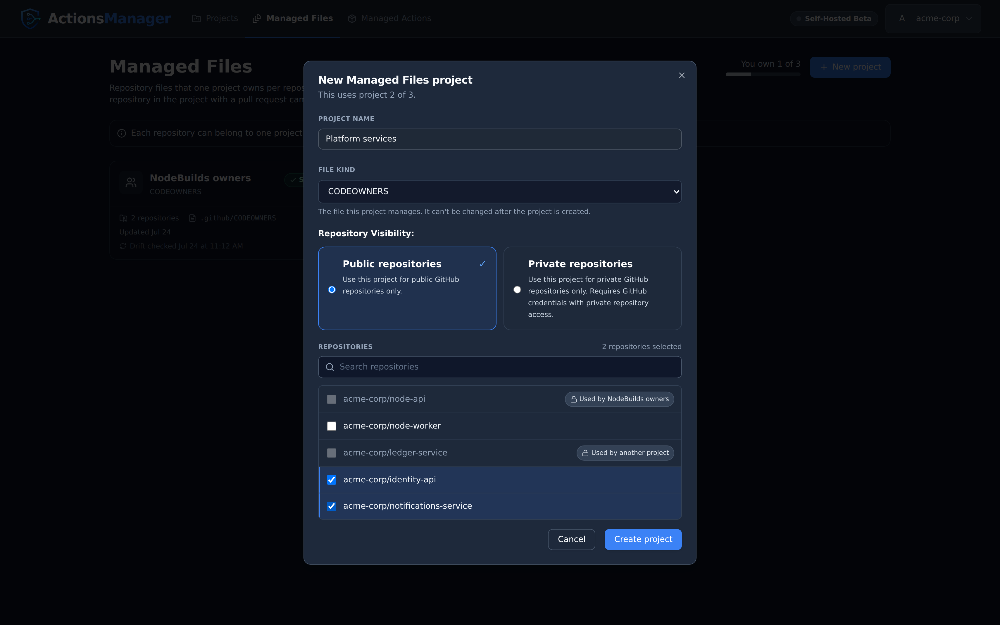
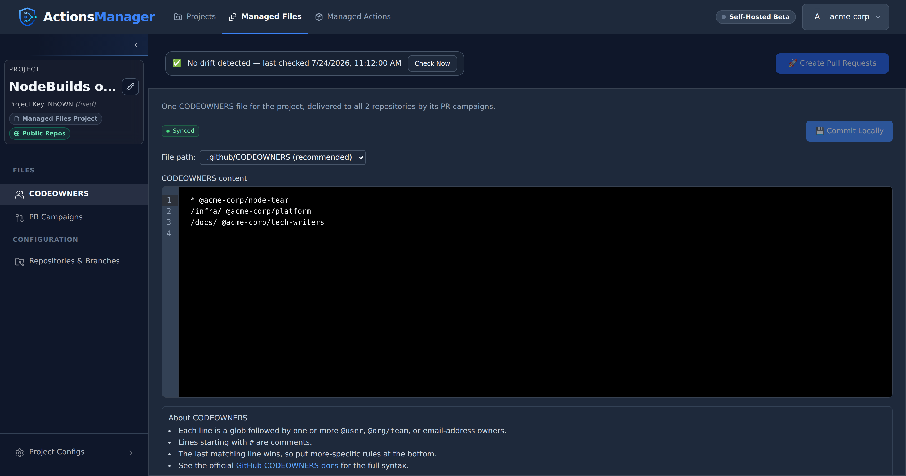

Manage one repository file, such as CODEOWNERS, across a group of repositories, with one project
owning the file in each repository.

---

## What is a Managed Files project?

Some files configure a whole repository rather than a workflow. GitHub reads one CODEOWNERS file
per branch, so a repository can only follow one set of code-ownership rules at a time. If two
projects both delivered a CODEOWNERS file to the same repository, the last pull request merged
would win, and each project would then report the other's change as drift.

A **Managed Files project** owns one such file for a group of repositories. It manages exactly one
**file kind**, chosen when the project is created and fixed from then on. Each repository can be
in **one project per file kind**, so for any repository there is never more than one project
writing its CODEOWNERS.

The kind available today is **CODEOWNERS**. A repository can be in a CODEOWNERS project and in any
number of [Caller and Reusable Workflow Projects](projects.html#project-types) at the same time.

Managed Files projects are listed only in their own section, never on the Projects page.

## The Managed Files section

Open it from the **Managed Files** tab in the app header, between **Projects** and **Managed Actions**.

Cards use the same layout as on the [Projects page](projects.html#the-projects-page). Each shows the project's name with its file kind under it, its state beside the menu, its file path, how many repositories it covers, and
when its file was last checked for drift. A drifted project names the repository that changed the
file on GitHub. A project owned by someone else in your workspace says who owns it.

## Creating a project

Choose **New project** and give the project:

- **A name.**
- **A file kind.** It can't be changed after the project is created.
- **Public or private repositories**, as for any project. Switching clears the repositories you
  picked.
- **Repositories.** A repository another project of the same kind already uses is greyed out,
  can't be selected, and says which project uses it, or "Used by another project" when that is a
  project you can't see.

The server enforces the same rule, so two people adding the same repository at the same moment
can't both succeed: the second is refused, and told which project uses it if they can see that
project.

### How many projects you can have

Managed Files projects have their own limit, counted across every file kind: **3 on the
self-hosted beta**. They don't count toward the Caller Workflow (4) and Reusable Workflow (2)
project limits, and those projects don't count toward it. The section shows how many you own,
and **New project** explains when you have reached the limit.

## Editing and delivering the file

A Managed Files project opens on its file, in the same editor and with the same
[PR campaigns](pr-campaigns.html) as every other project:

- **Commit Locally** saves your change. The file reads **Draft changes** until a campaign
  delivers it.
- **Create Pull Requests** opens one pull request per repository and branch, carrying only the
  file. Each is called `[Actions Manager] Update <project key> files`; a campaign name you give
  heads its description.
- The file can live at `.github/CODEOWNERS`, `CODEOWNERS` or `docs/CODEOWNERS`, the places GitHub
  reads it from, in that order.
- A project with no file yet can start from one of its repositories' copies: choose the
  repository and **Load from repository**, then **Commit Locally**.

How the file's drift is detected and resolved is described in
[CODEOWNERS Drift](drift-detection.html#codeowners-drift).

The project has only the sections that apply to one file:

- **Repositories & Branches**, with branch settings. Repositories another project of the kind uses
  are locked here too, and adding a repository offers to
  [deliver the file to it](projects.html#adding-a-repository-to-a-project-that-already-has-files).
  Saving a change here makes a synced project a draft, so **Create Pull Requests** can deliver the
  file to new repositories and branches; the ones that already have it are left alone.
- **PR Campaigns**.
- **Project Configs**: Project Info, Project Members, Drift Detection, Export Config and Danger
  Zone.

It has no workflows, build metrics, deployment environments, environment variables, secrets,
rulesets, validation repository, naming mode or project color. While it's open, the app header
marks **Managed Files** as the current section, and that tab returns to it.

## CODEOWNERS moved here from workflow projects

CODEOWNERS used to be managed in Caller and Reusable Workflow Projects. It is now managed only
here:

- A Caller or Reusable Workflow Project can't save or import a CODEOWNERS file. Where its
  CODEOWNERS row was, **Project Files** says *CODEOWNERS is now managed in Managed Files*, with a
  link to this section.
- No project can hold a [custom file](drift-detection.html#custom-file-drift) at a path GitHub
  reads CODEOWNERS from.
- Upgrading deletes the CODEOWNERS files that Caller and Reusable Workflow Projects kept, and any
  custom file at a CODEOWNERS path, along with their delivery and drift records. **Files in your
  repositories are not touched.** To keep managing one, create a CODEOWNERS project for those
  repositories and load the file from one of them. A project whose only drift was in those files
  stops showing drift.
- A change to one of those files that was committed locally but never delivered exists only in
  ActionsManager, so upgrading loses it. Deliver it, or copy it, before you upgrade.
- Rolling back an older campaign of a workflow project leaves any CODEOWNERS file it delivered as
  it is, since it belongs to Managed Files now. The rollback preview names the file it leaves.

:::note[A pull request still open after upgrading]
A workflow project's pull request that was carrying CODEOWNERS still merges or closes as usual.
Once merged, that CODEOWNERS file is no longer managed by ActionsManager until a CODEOWNERS project
takes the repository. If a CODEOWNERS project delivers to the repository while that pull request
is still open, merging it afterwards overwrites the CODEOWNERS project's file, which then reports
drift, or GitHub reports a merge conflict. Merge or close it first.
:::

## Related Topics

- [Projects](projects.html) — the workflow project types
- [PR Campaigns](pr-campaigns.html) — how the file is delivered
- [Drift Detection](drift-detection.html#codeowners-drift) — when the file changes on GitHub
