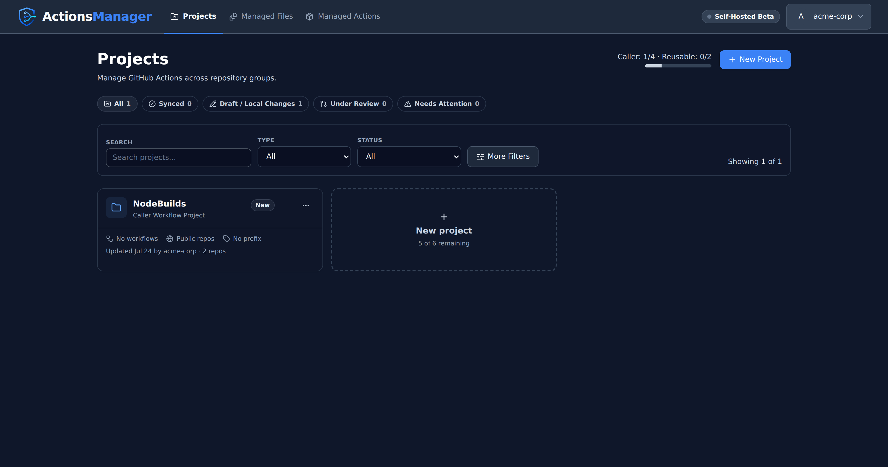
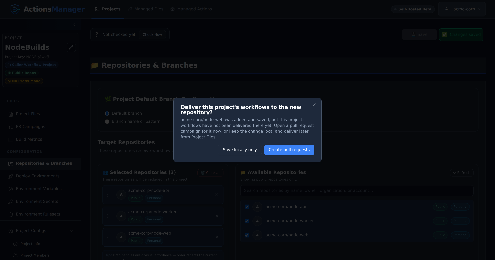

Projects are the primary organizational unit in ActionsManager, grouping related repositories for coordinated workflow management.

---

## What is a Project?

A **project** in ActionsManager is a named collection of repositories that share a workflow management scope. Projects are the unit you operate on — permissions, workflows, secrets, and rollouts are all coordinated at the project level.

Instead of managing workflows repository by repository, you group related repositories into a project and apply changes to all of them in a single operation.

## Project Types

ActionsManager uses two workflow project types that reflect the two sides of GitHub Actions reusability:

### Caller Workflow Project

A **Caller Workflow Project** (referred to internally as `standard`) manages the repositories whose workflows *call* reusable workflows using the `uses:` directive.

Use this project type when you want to:
- Manage multiple repositories that share a common workflow pattern
- Apply, update, or remove caller workflows across a fleet of repositories
- Keep all repositories synchronized against a shared workflow definition

### Reusable Workflow Project

A **Reusable Workflow Project** (referred to internally as `rwx`) manages the *producer* side — the repository that defines and publishes the reusable workflows that other repositories call.

Use this project type when you want to:
- Author and version reusable workflow definitions centrally
- Track which caller workflows across your organization reference your reusable workflows
- Propagate changes from the producer to all consumers

### Working Together

The real power of ActionsManager comes from managing both project types together. When a reusable workflow changes in a producer project, ActionsManager identifies which caller projects are affected and can roll out the update across the entire consumer fleet.

### Managed Files Project

A **Managed Files project** manages one repository file, such as CODEOWNERS, for a group of
repositories, with one project per repository for each kind of file. These projects are listed in
their own section; see [Managed Files](managed-files.html).

## The Projects Page

Each project is a card:

- **The header** has the project's identity color, its name, its type ("Caller Workflow Project" or "Reusable Workflow Project") under the name, and its status beside the three-dot menu. A drift chip appears beside the status when there is something to report about drift.
- **The body** below the divider shows the workflow count, whether the project uses **Public repos** or **Private repos**, and **Prefix** or **No prefix** naming. Under that are when the project was last updated and by whom, and when drift was last checked.

Click anywhere on a card to open the project. Cards are laid out three to a row on wide screens, two on medium and one on narrow ones. [Managed Files](managed-files.html) uses the same card layout, grid and dashed **New project** box.

The last item in the grid is a dashed **New project** box. It shows how many projects your plan has room for ("2 of 3 remaining", counted across both project types) and is hidden once you reach your limit. Beside the **New Project** button, a small meter shows your usage: one figure when your plan has a single project limit, or Caller and Reusable figures when it limits each type. Your plan's name, with an **Upgrade** link when it has one, is a chip beside your avatar in the app header on every page.

## Creating a Project

1. Click **New Project** in the dashboard, or the dashed **New project** box
2. Choose a project type (Caller Workflow or Reusable Workflow)
3. Name the project
4. Add repositories to the project

## Managing Repositories

Within a project you can:
- **Add repositories** — include repositories from your GitHub account or organizations
- **Remove repositories** — take a repository out of scope without deleting its workflows
- **Configure per-repository settings** — specify branches, labels, and delivery preferences

### Adding a Repository to a Project That Already Has Files

Adding a repository does not push anything to it. The repository joins the project's scope, but
the project's existing files (its workflows and custom files, or a Managed Files project's file)
are not in it yet — and
because nothing has ever been delivered there, it is
[not reported as drift](drift-detection.html#what-counts-as-drift) either. Without a prompt, a
newly added repository could sit empty indefinitely with nothing saying so.

So when you press **Save** in **Repositories & Branches** having added one or more repositories,
ActionsManager asks how to deliver the project's workflows to them (a Managed Files project's
file, for one of those):

| Choice | What happens |
|--------|--------------|
| **Save locally only** | Nothing is pushed. The repository stays in the project, and no drift is reported. Deliver whenever you're ready from **Project Files** (in a Managed Files project, from the file's own item, such as **CODEOWNERS**). |
| **Create pull requests** | Opens a [PR campaign](pr-campaigns.html) limited to the repositories you just added. Every workflow and custom file in the project, or a Managed Files project's file, is pre-selected, because the new repository has none of them. A custom file changed on GitHub is offered unticked, so overwriting that change stays your choice. |

Dismissing the prompt is the same as choosing **Save locally only** — the repository was already
saved before the prompt appeared, so nothing is lost either way.

### Keeping Track of What's Still Waiting

Choosing **Save locally only** is not the end of the story, so ActionsManager keeps a standing
reminder until the workflows (or a Managed Files project's file) land. It appears in three places, each a
different level of detail:

- **A count beside Repositories & Branches** in the sidebar, so the reminder is reachable from
  anywhere in the project.
- **A note at the top of the project**, next to the drift status row, naming the repositories and
  offering to open the pull requests.
- **A "Not delivered yet" badge** on each waiting repository in the Selected Repositories list.

None of it is styled as a warning, because nothing is wrong — the repository simply hasn't received
the files yet. All three clear themselves: opening a pull request pauses the reminder while it is in
review, and merging it removes the repository from the list for good.

The reminder only appears for repositories ActionsManager has genuinely never delivered to. In a
project with workflows that means its workflows: a repository that received only a custom file
is still waiting for them. A Managed Files project waits on its
file instead. It stays quiet on a project that has never been [drift-checked](drift-detection.html),
because until the first check there is no evidence either way, and guessing would mean telling you
that repositories you delivered to months ago are still waiting.

While a repository is waiting, **Create Pull Requests** stays available even when the project is
synced, and opens the campaign for the waiting repositories, so you can deliver to them at any time.

One thing the campaign does *not* carry:

- **Linked reusable workflows.** Those are delivered to the repository of the Reusable Workflow
  Project that owns them, not to caller repositories, so a new caller repository does not need
  them pushed to it.

A Caller Workflow Project's **own** reusable workflows are different: they are delivered to the
project's repositories like its regular workflows, so the campaign for a new repository
pre-selects all of them, as it does the regular workflows.

Removing a repository never prompts — there is nothing to deliver.

## Branch Configuration

**Repositories & Branches** decides which branches a project writes to. The same answer is used for
[drift detection](drift-detection.html#which-branches-are-checked), so a project is
always compared against the branches it actually delivers to — never against a branch nobody chose.

| Option | What it targets |
|--------|-----------------|
| **Default branch** | Each repository's own GitHub default branch |
| **Branch name or pattern** | Every branch matching the name or regular expression you enter (`main`, `release-.*`, `feature/auth`) |

Pattern mode adds a **Max branch age** (1–30 days, 30 by default): only branches with a commit
inside that window are targeted, so stale branches matching the pattern are left alone. If a pattern
matches nothing — or every match is older than the window — ActionsManager falls back to the
repository's default branch.

**Per-repository override.** Each repository in the list either uses **Use project default** or
**Override for this repository**, which gives that one repository its own option, pattern and age
window. Everything else in the project keeps the project setting.

## Ordering Projects

The Projects dashboard keeps the arrangement you choose. Drag a card by its grip
handle (to the left of the three-dot menu, shown when you hover over the card or focus the handle, and always visible on touch screens) and drop it anywhere in the grid.

- **Opening or editing a project no longer moves its card.** The dashboard used to
  sort by last-updated time, so simply viewing a project pushed it to the front.
- **Your order is your own.** It is saved per user, so rearranging your dashboard
  never changes what a teammate sees.
- **It follows you.** The order persists across refreshes, sessions, browsers and
  devices, because it is stored on the server rather than in the browser.
- **New projects appear at the end**, so an existing arrangement is never disturbed.
- **Reordering is disabled while searching or filtering.** A filtered grid only shows
  some of your projects, and saving from that view would lose the position of the
  hidden ones. Clear the filters to re-enable the handles — your full order is
  preserved while filtering.

Dragging never opens a project: clicking a card still navigates, and the three-dot
menu keeps working as before. If an order fails to save, the grid returns to its
previous arrangement and shows an error rather than leaving the dashboard and the
server out of step.

The first time you open the dashboard, projects are arranged most-recently-updated
first and that arrangement is saved as your starting point.

## Project Permissions

Access to a project is tied to your GitHub authentication. You can only manage repositories that your configured GitHub token or OAuth session can access.

### Renaming a Project

A project's display name is editable in place from the project sidebar. The project
code is not — it is fixed at creation, and the workflow filenames delivered in
[prefix mode](workflows.html#workflow-names-across-projects) are
built from it, so a project rename never renames or rewrites a managed file.

Project names are unique per owner. A rename to a name the project's owner already
uses for another project, in any capitalization, is refused and the name stays as it
was. Creating a project with a name you already use is refused the same way, and your
existing project is left untouched. A name only another owner uses is free.

It is not completely invisible to your repositories, though. ActionsManager writes the
project name into each campaign pull request's description, as a link back to the
project's PR Campaigns view. Pull requests opened before the rename keep the old name,
and their link no longer resolves; pull requests opened after it carry the new one.
Rename between campaigns if that matters to your reviewers.

Renaming a project requires **editor** access to it. Project viewers can open the
project and read it, but the rename is rejected. Project owners and workspace admins
always qualify.

## Deleting a Project

Delete a project from **Project Configs → Danger Zone**. The dialog asks what happens to the
project's files in GitHub: its workflows, reusable workflows and custom files, or a Managed Files
project's file.

| Choice | What happens |
|--------|--------------|
| **Delete the project, keep its files in GitHub** | The project is deleted from ActionsManager at once. Its files stay in your repositories exactly as they are, and nothing manages them any more. |
| **Delete the project and remove its files from GitHub** | ActionsManager opens a [PR campaign](pr-campaigns.html) named *Delete project &lt;name&gt;*: one pull request per repository and branch it delivered any of the project's files to, each removing all of them from that branch. Nothing is committed directly. |

Before you confirm, the dialog lists those pull requests by repository and branch, with the
files each one removes. The list comes from ActionsManager's record of what it delivered where,
so each file is removed at the path it was delivered to, on every branch it was delivered to,
including branches the project no longer targets. A file ActionsManager has no record of
delivering, such as one delivered by an earlier release, is listed as not removed: if it is in
GitHub, remove it yourself.

If the record shows nothing delivered, or every file is already gone from its branch, there is
nothing to review and the project is deleted at once.

### While the pull requests are open

The project shows **Deleting** and is read-only for everyone, workspace admins included. Its
pull requests can still be merged and closed from PR Campaigns.

- When every one of them has merged, the project is deleted.
- Closing any of them calls the deletion off. The project stays and can be edited again. A file
  a merged pull request already removed is shown as **Committed Locally**, ready to deliver
  again; the others stay in GitHub unchanged.

If a pull request could not be opened for some repository and branch, the result names it. The
files there are still delivered, so once the other pull requests have merged the deletion is
called off rather than finished. If no pull request could be opened at all, nothing changes and
the project is not deleted.

### When removing the files is not available

The second choice is disabled, with the reason shown, when:

- the project has an open pull request, or another project's open pull request carries one of
  its files. Merge or close them first.
- it is a Reusable Workflow Project that Caller Workflow Projects link to. Removing its reusable
  workflows would break the `uses:` lines that call them. Unlink those projects first.
- some of its files are in repositories that are no longer in the project. Add those
  repositories back so their files can be removed too.

Deleting the project and keeping its files is always available.

### Secrets and variables

Secrets, variables and deployment environments cannot be removed by a pull request, so they are a
separate checkbox: **Also delete secrets and variables now**. With either choice above, it deletes
the project's secrets and variables (those named with its `AM_<CODE>_` prefix, or, for a project
that does not use the prefix, the ones it tracks) from its repositories immediately. This cannot
be undone, and calling the deletion off does not bring them back.

Unless you also tick **Keep deployment environments**, every deployment environment in the
project's repositories is deleted as well, not only ones the project created.

## Related Topics

- [Workflows](workflows.html) — manage workflow content across project repositories
- [PR Campaigns](pr-campaigns.html) — roll out changes through reviewable pull requests
- [Drift Detection](drift-detection.html) — detect when repositories diverge from the managed state
- [Reusable Workflows](reusable-workflows.html) — manage producer-consumer workflow relationships
